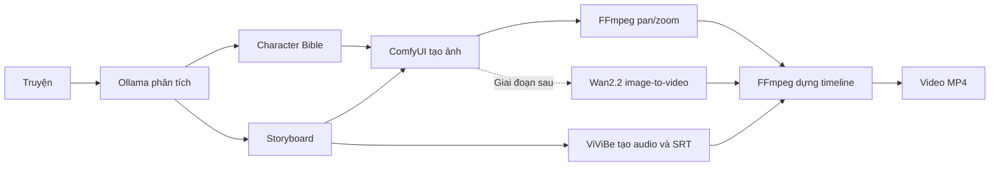

# 00 — Tổng quan RenderVideo

[← Mục lục](../README.md) · [Tiếp theo: Thư mục và cài đặt →](01-thu-muc-va-cai-dat.md)

## Mục tiêu

RenderVideo chuyển một câu chuyện thành video có hình ảnh, giọng kể, phụ đề, nhạc và hiệu ứng âm thanh.

Đầu vào:

- Nội dung truyện.
- Ngôn ngữ và phong cách hình ảnh.
- Tỷ lệ khung hình: `16:9`, `9:16` hoặc `1:1`.
- Giọng đọc ViViBe.

Đầu ra:

- Video MP4.
- Phụ đề SRT.
- Storyboard JSON.
- Ảnh, audio và clip riêng của từng cảnh.
- Metadata đủ để tạo lại một cảnh.

## Luồng xử lý

## Quyết định kỹ thuật

- RenderVideo là bộ điều phối; các công cụ AI nằm sau adapter.
- MVP dùng ảnh tĩnh với pan/zoom. Wan2.2 là nâng cấp sau khi pipeline cơ bản ổn định.
- ViViBe chạy ngoài máy nên không cài TTS local.
- Mọi tác vụ lâu chạy qua hàng đợi, không giữ HTTP request của người dùng.
- Người dùng duyệt storyboard và ảnh trước khi phát sinh tác vụ tốn chi phí.
- Audio thực tế quyết định thời lượng cảnh.

## Công cụ

| Chức năng | Công cụ |
|---|---|
| Phân tích truyện | [Ollama](https://github.com/ollama/ollama) |
| Tạo ảnh/workflow | [ComfyUI](https://github.com/Comfy-Org/ComfyUI) |
| Tạo giọng Việt | [ViViBe API](https://www.vivibe.app/api-docs.html) |
| Dựng video | [FFmpeg](https://github.com/FFmpeg/FFmpeg) |
| Image-to-video | [Wan2.2](https://github.com/Wan-Video/Wan2.2), triển khai sau MVP |
| Backend | FastAPI, PostgreSQL, Redis và RQ |

## Điều kiện hoàn thành MVP

1. Nhập và lưu truyện.
2. Sinh storyboard đúng schema.
3. Duyệt nhân vật và cảnh.
4. Tạo ảnh cho từng cảnh.
5. Nhận audio/SRT từ ViViBe.
6. Render MP4 bằng FFmpeg.
7. Tạo lại riêng một cảnh.
8. Khởi động lại ứng dụng mà không mất trạng thái job hoặc tài nguyên.