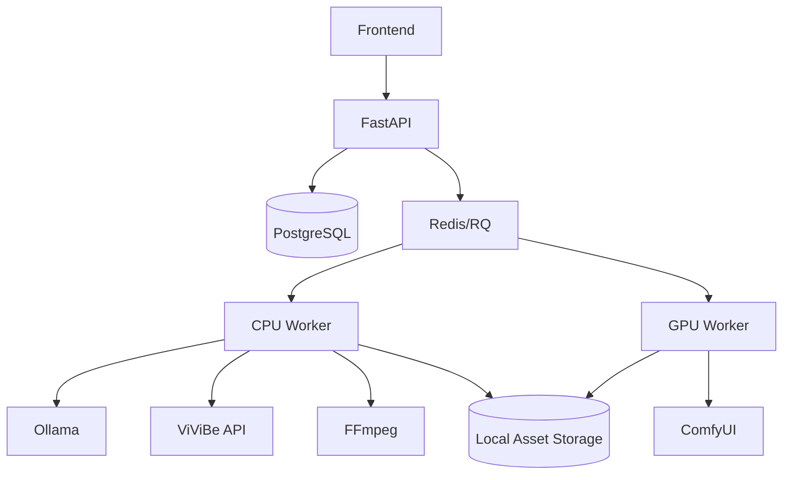

# 02 — Kiến trúc và dữ liệu

[← Thư mục và cài đặt](01-thu-muc-va-cai-dat.md) · [Mục lục](../README.md) · [Tiếp theo: Storyboard →](03-storyboard-ollama.md)

## Kiến trúc dịch vụ



Không nhúng source Ollama, ComfyUI hoặc Wan2.2 vào backend. RenderVideo gọi chúng qua adapter HTTP/CLI.

## Phân chia worker

Queue `cpu`:

- Phân tích truyện.
- Gọi và theo dõi ViViBe.
- Tải audio/SRT.
- Tạo phụ đề.
- Chạy FFmpeg.

Queue `gpu`:

- Tạo ảnh nhân vật.
- Tạo ảnh cảnh.
- Upscale.
- Image-to-video ở giai đoạn sau.

Một máy chỉ nên chạy một GPU generation job tại một thời điểm để tránh tranh chấp VRAM.

## Cấu trúc mã nguồn

```text
backend/
├── api/
│   ├── projects.py
│   ├── characters.py
│   ├── scenes.py
│   └── renders.py
├── domain/
│   ├── project.py
│   ├── character.py
│   ├── scene.py
│   └── asset.py
├── providers/
│   ├── story/ollama.py
│   ├── media/comfyui.py
│   ├── speech/vivibe.py
│   └── render/ffmpeg.py
├── services/
│   ├── storyboard_service.py
│   ├── asset_service.py
│   └── render_service.py
├── storage/
└── workers/
```

## Trạng thái project

```text
draft
→ analyzing
→ awaiting_storyboard_review
→ generating_assets
→ awaiting_asset_review
→ generating_audio
→ rendering
→ completed
```

Trạng thái job ngoài:

```text
queued → submitted → processing → completed
                              └──→ failed
```

`external_job_id` phải được lưu ngay sau khi provider trả về để worker có thể tiếp tục sau khi restart.

## Dữ liệu cảnh tối thiểu

```json
{
  "id": "scene_001",
  "order": 1,
  "duration_seconds": 7.0,
  "character_ids": ["little_red"],
  "location": "căn nhà cạnh khu rừng",
  "narration": "Ngày xửa ngày xưa...",
  "image_prompt": "...",
  "motion_prompt": "...",
  "seed": 12345,
  "status": "draft"
}
```

## Asset metadata

Không lưu binary trong PostgreSQL. Database lưu:

```json
{
  "kind": "narration_audio",
  "local_path": "data/projects/demo/scenes/scene_001/narration.wav",
  "sha256": "...",
  "provider": "vivibe",
  "model": null,
  "external_job_id": "...",
  "metadata": {
    "voice_id": "...",
    "speed": 1.0,
    "duration_seconds": 8.32
  }
}
```

## Idempotency

Khóa asset được tạo từ:

```text
project_id + scene_id + operation + normalized_input
+ provider + model/workflow_version + seed
```

Nếu asset cùng khóa đã hoàn thành thì dùng lại. Không gọi lại API trả phí hoặc tạo lại ảnh khi không có thay đổi đầu vào.